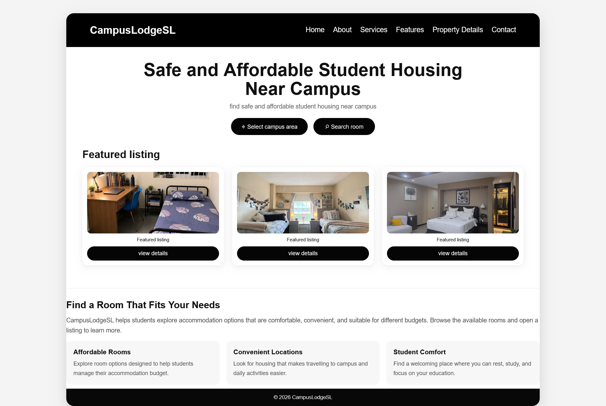
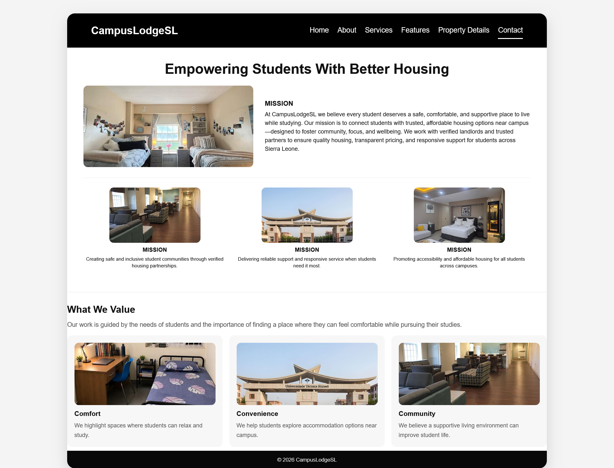
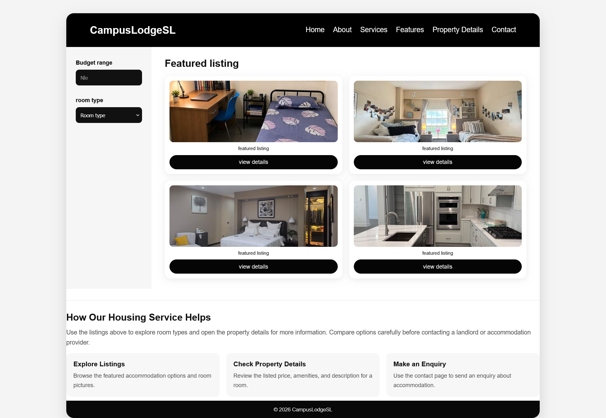
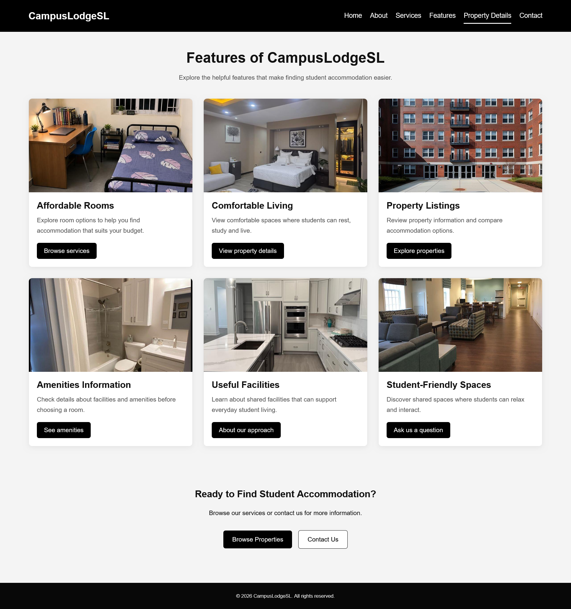
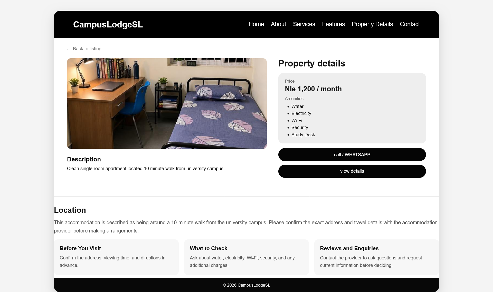
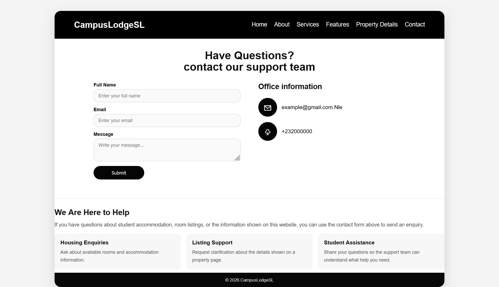

 CampusLodgeSL – Student Accommodation Website

1. Project Overview

CampusLodgeSL is a student accommodation website designed to help students explore housing options near their campus. The website provides information about accommodation, room facilities, property details, and contact information in a clear and organized format.

The project aims to make it easier for students to explore available rooms, view property images, learn about accommodation facilities, and find information before making housing enquiries. The website uses a simple black-and-white design, clear navigation links, image cards, and buttons to help visitors move between its different pages.

2. Project Objectives

The main objectives of CampusLodgeSL are to:

- Help students explore accommodation options near their campus.
- Display room and building images to make property listings easier to understand.
- Provide information about room prices, facilities, and property descriptions.
- Present the services and features available on the website.
- Explain the purpose and values of the project.
- Provide a contact page for enquiries.
- Connect the website pages through a consistent navigation menu.

3. Technologies Used

- HTML5: Used to structure the website pages and their content.
- CSS3: Used to style the pages, navigation bar, buttons, image cards, spacing, and layout.
- PEG Images: Used to display accommodation rooms, facilities, and buildings.

4. Website Pages

CampusLodgeSL contains six main pages.

 4.1 Home Page

The Home page is the main landing page of the website. It introduces CampusLodgeSL with the heading “Safe and Affordable Student Housing Near Campus.” It includes options for selecting a campus area and searching for rooms. The Featured Listing section displays accommodation cards with images and buttons for viewing property details. A lower section highlights affordable rooms, convenient locations, and student comfort.

4.2 About Page

The About page explains the purpose and mission of CampusLodgeSL. It introduces the goal of helping students explore safe, comfortable, and affordable accommodation options. The page also highlights the values of comfort, convenience, and community, supported by images of rooms and buildings.

4.3 Services Page

The Services page presents featured accommodation listings. It includes budget-range and room-type controls to help visitors consider their housing needs. The listing cards display accommodation images and buttons for viewing more property information. Additional content explains how visitors can explore listings, check property details, and make enquiries.

4.4 Features Page

The Features page highlights the main benefits and facilities associated with student accommodation. These include affordable rooms, comfortable living, property listings, amenities information, useful facilities, and student-friendly spaces. Images and cards help visitors understand the features presented.

4.5 Property Details Page

The Property Details page provides more information about a selected accommodation. It displays a room image, a monthly rental price, a room description, and amenities such as water, electricity, Wi-Fi, security, and a study desk. The page also includes contact options and guidance about checking the location and property information before making arrangements.

4.6 Contact Page

The Contact page provides a way for students and visitors to make enquiries. It contains fields for a full name, email address, and message, together with office contact information. It also presents support information covering housing enquiries, listing support, and student assistance.

5. Main Website Features

The main features of CampusLodgeSL include:

- A welcoming home page.
- A navigation menu connecting the main website pages.
- Featured accommodation listings with images.
- Property details and amenity information.
- Accommodation-related services and features.
- An About page describing the project's purpose.
- A Contact page for enquiries.
- A consistent black-and-white design.
- A footer containing website information.

*Note: The contact form and search controls are part of the website interface. They should not be assumed to process or store information unless the required back-end or form service has been connected.*

6. Project Folder Structure

The main project files are organized as follows:

```text
CampusLodgeSL/
├── index.html
├── about.html
├── services.html
├── features.html
├── property-details.html
├── contact.html
├── style.css
├── README.md
├── images/
└── screenshots/
    ├── home.png
    ├── about.png
    ├── services.png
    ├── features.png
    ├── property-details.png
    └── contact.png
```

The `images` folder contains the images used within the website itself. The `screenshots` folder contains screenshots of the completed website pages for documentation purposes.

Keep the actual filenames and folder paths consistent with the ones referenced in your HTML and README files.

7. Website Screenshots

The following screenshots show the main pages of CampusLodgeSL. They are arranged in a consistent order, beginning with the Home page and ending with the Contact page.

7.1 Home Page

The Home page introduces the purpose of the website and displays featured accommodation listings. Visitors can explore the available room options and use the navigation menu to move to other pages.



7.2 About Page

The About page explains the mission and values of CampusLodgeSL. It emphasizes the importance of comfortable accommodation, convenient locations, and a positive student living environment.



 7.3 Services Page

The Services page displays featured accommodation options and provides controls for considering budget and room type. The property cards help visitors explore rooms and access further details.



7.4 Features Page

The Features page presents the main accommodation benefits, including affordability, comfortable living, property listings, amenities, useful facilities, and student-friendly spaces.



 7.5 Property Details Page

The Property Details page displays a selected room, its price, description, and listed amenities. It also provides contact options and information that can help visitors assess the accommodation.



 7.6 Contact Page

The Contact page provides a contact form and office information. It is intended to help visitors make housing enquiries and find support related to accommodation listings.



8. How to View the Website

To view CampusLodgeSL locally:

1. Open the project folder on your computer.
2. Confirm that the HTML files, `style.css`, and `images` folder are present.
3. Open `index.html` in a web browser such as Google Chrome.
4. Use the navigation menu to explore the Home, About, Services, Features, Property Details, and Contact pages.

If the website has been published using GitHub Pages, visitors can open the published website link in their browser.

9. Conclusion

CampusLodgeSL is a student accommodation website project that organizes housing-related information into six connected pages. It allows visitors to explore accommodation listings, review property details, learn about available features, understand the project's purpose, and find contact information.

The project demonstrates the use of HTML to structure web pages and CSS to create a consistent and accessible visual presentation. In the future, the website could be improved by adding verified property listings, functional search and filtering, and a secure system for processing enquiries.
