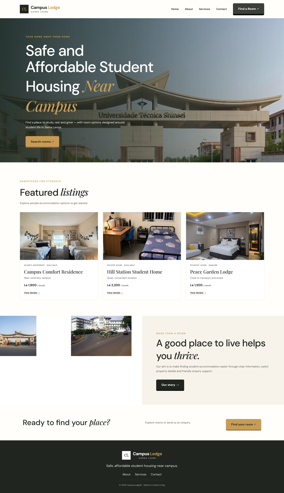
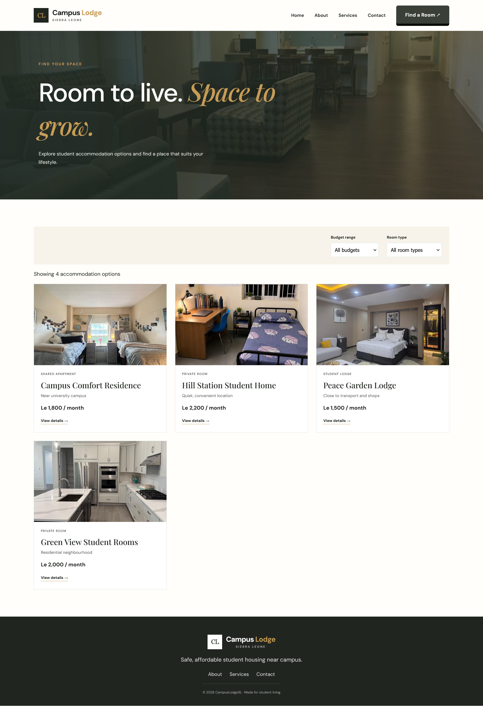

CAMPUS LODGE – STUDENT ACCOMMODATION WEBSITE

1. Project Overview

Campus Lodge is a student accommodation website designed to help students find suitable, comfortable, and convenient places to stay while pursuing their education. Finding safe and affordable accommodation is an important part of student life, especially for students who travel from different towns and communities to attend college or university.

The purpose of this project is to develop a simple, attractive, and user-friendly website where students can explore accommodation facilities, view room options, learn more about the lodge, and contact the management for further information.

The website provides information about the available rooms and facilities through organised sections, photographs, navigation links, and buttons. It is designed to make it easier for visitors to understand what Campus Lodge offers.

 2. Aim of the Project

The main aim of the Campus Lodge project is to design and develop a functional student accommodation website using fundamental web development technologies.

The project also aims to improve the presentation of accommodation information and provide visitors with a convenient way to explore the lodge's services through a website.

 3. Objectives of the Project

The objectives of the Campus Lodge website are to:

- Design an attractive and professional website for student accommodation.
- Provide information about Campus Lodge and its services.
- Display room photographs to help visitors understand the available accommodation options.
- Present important facilities, including shared spaces and other accommodation features.
- Provide clear navigation links so users can move between the different pages.
- Include contact information to help visitors make enquiries.
- Provide a booking section where visitors can explore the booking process.
- Practise the use of HTML, CSS, and JavaScript in developing a website.
- Apply good website design principles, including readability, organisation, consistency, and user-friendly navigation.
- Develop practical skills in organising project files and publishing a website using GitHub.

4. Website Features

 4.1 Home Page

The home page introduces visitors to Campus Lodge. It contains a main banner with a building photograph, introductory text, and a clear call-to-action button. The page gives visitors a first impression of the accommodation and directs them to explore the website.

4.2 About Page

The About page provides information about Campus Lodge, its purpose, and the accommodation experience it aims to provide for students. It helps visitors understand the website and the services associated with the lodge.

 4.3 Services and Accommodation

The Services section presents accommodation options and facilities available at the lodge. It can include different room types and photographs that help students compare the available options.

The website uses room images to make the information more visual and easier to understand.

Services Page

 4.4 Room and Facility Images

Campus Lodge includes photographs representing different rooms and facilities. These images help visitors visualise the accommodation environment before making an enquiry.

The project image collection includes:

- Building photograph
- Entrance photograph
- Single room
- Shared room
- Premium room
- Kitchen
- Common room
- Bathroom

The images are stored in the `images` folder and are referenced by the website's HTML and CSS files.

4.5 Booking 

The Booking page provides a section for visitors who want to enquire about accommodation or explore the booking process. It helps organise the information required from prospective residents.

Add your Booking page screenshot here if you have taken one.

4.6 Contact Page

The Contact page provides a place for visitors to find contact details or submit enquiries, depending on the features implemented on the page. It supports communication between prospective residents and the accommodation management.

 Contact Page

4.7 Navigation Menu

The navigation menu helps visitors move between the main pages of the website. It includes links such as Home, About, Services, and Contact, together with a prominent “Find a Room” button.

A consistent navigation menu makes the website easier to use and helps visitors find information without unnecessary difficulty.

4.8 Website Footer

The footer appears at the bottom of the website pages. It provides a consistent finishing section and may contain the Campus Lodge name, a short description, and other relevant information.

Using a consistent footer helps maintain a uniform appearance throughout the website.

5. Technologies Used

HTML (HyperText Markup Language)

HTML is used to create the structure and content of the website. It defines the headings, paragraphs, images, links, buttons, navigation sections, and other elements displayed in the browser.

CSS (Cascading Style Sheets)

CSS is used to control the appearance of the website. It defines the colours, fonts, spacing, layouts, image presentation, navigation menu, buttons, and footer.

The styling helps make the website more attractive, readable, and consistent across its pages.

JavaScript

JavaScript is used to provide interactive behaviour where required. It can support actions such as menu interactions, form validation, and other dynamic features implemented in the project.

6. Project File Structure

The project is organised into separate files to make the code easier to read, maintain, and update.

The main project files are:

- `index.html` – the main home page.
- `about.html` – the About page.
- `accommodation.html` – the accommodation and services page.
- `booking.html` – the booking page.
- `contact.html` – the Contact page.
- `property-details.html` – the property details page, if included in the current version.
- `style.css` – contains the website's styling.
- `script.js` – contains JavaScript functionality.
- `images/` – contains the photographs used throughout the website.

Keeping the files organised makes it easier to identify the purpose of each file and update the website when necessary.

 7. Website Design and User Experience

The Campus Lodge website is designed with attention to appearance, readability, and ease of navigation. The use of building, room, and facility photographs gives visitors a clearer understanding of the accommodation.

The design uses gold and black accents to create a recognisable visual style. Buttons are styled to stand out from ordinary text, making important actions easier to identify.

The pages are organised into clear sections so that visitors can browse the information without feeling overwhelmed. Consistent navigation and footer styling also help create a unified appearance across the website.

 8. How to Access the Website

The website is published through GitHub Pages and can be opened in a web browser using the link below:

10. Learning Outcomes

Developing the Campus Lodge website provides practical experience in website development and project organisation.

Through this project, the following skills can be developed:

- Creating web pages using HTML.
- Styling web pages using CSS.
- Using JavaScript to support website interactions.
- Adding and organising images in a website project.
- Creating navigation links between pages.
- Designing buttons and content sections.
- Maintaining consistent design across multiple pages.
- Organising source code into separate files.
- Uploading project files to GitHub.
- Publishing a website using GitHub Pages.
- Writing project documentation using a README file.

The project also demonstrates how different web technologies work together to create a complete website.
11. Future Improvements

The Campus Lodge website could be improved further by introducing additional features, depending on the project's requirements. Possible improvements include:

- Adding more accommodation photographs and detailed room descriptions.
- Providing clearer room availability information.
- Introducing a more complete online booking system.
- Adding form validation and clearer submission feedback.
- Improving accessibility for visitors using different devices.
- Enhancing the mobile layout for smaller screens.
- Providing additional information about accommodation facilities and services.

These improvements could make the website more useful and provide a better experience for prospective residents.

12. Conclusion

Campus Lodge is a student accommodation website project that demonstrates the practical application of HTML, CSS, and JavaScript in creating a structured and visually appealing website. It presents accommodation information through organised pages, photographs, navigation links, and clearly styled buttons.

The project also provides practical experience in managing website files, documenting development work, using GitHub, and publishing a website with GitHub Pages.

Overall, the project serves as an opportunity to apply web design principles and develop the technical skills required to build and maintain a website. It can also provide a foundation for future improvements, including more advanced accommodation information and booking functionality.

